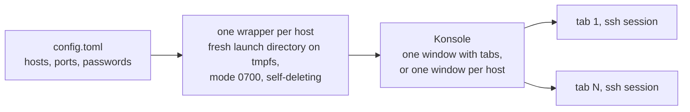

# SshAutoLogin.jl

[](https://github.com/PaulGoG/SshAutoLogin.jl/actions/workflows/CI.yml?query=branch%3Amain)
[](https://github.com/JuliaTesting/Aqua.jl)
[](https://github.com/aviatesk/JET.jl)
[](https://github.com/jrevels/YASGuide)
[](https://github.com/PaulGoG/SshAutoLogin.jl/actions/workflows/Format.yml?query=branch%3Amain)
[](https://julialang.org/downloads/)
[](#environment-setup)

Opens one KDE Konsole tab, or one window, per remote host listed in a TOML file and logs in to each with its password.

```
SshAutoLogin.jl/
├── src/                   # Package: configuration parser, wrapper scripts, launcher, CLI driver
├── scripts/run.jl         # Command-line entry point
├── test/                  # Test suite and its environment
├── format/                # Formatting environment and script
├── config.example.toml    # Configuration template
├── activate.jl            # Activates and instantiates the root environment
├── Project.toml
├── CHANGELOG.md
└── SECURITY.md
```

The complete tree is under [Repository layout](#repository-layout).

## Environment setup

Linux with a systemd user session: the launcher writes its scripts under `XDG_RUNTIME_DIR` and refuses to run without it. I develop and test on Fedora with KDE Plasma, and any distribution that ships Konsole should work. Konsole, Bash, the OpenSSH client, and `sshpass` 1.06 or newer are required:

```bash
sudo dnf install konsole openssh-clients sshpass
```

Julia 1.10 or newer.

Clone the repository and instantiate the environments:

```bash
git clone https://github.com/PaulGoG/SshAutoLogin.jl.git
cd SshAutoLogin.jl
julia activate.jl          # root environment
julia test/activate.jl     # test environment, developed against the local source
julia format/activate.jl   # formatting environment
```

The package is not registered; run it from the clone.

## Entry points

Copy the template with mode 600 and fill in the targets. The loader refuses a configuration file that grants any permission to group or others, and git ignores every `.toml` file in the clone except the tracked ones.

```bash
install -m 600 config.example.toml config.toml
```

| Task | Command |
|---|---|
| Open all sessions | `julia scripts/run.jl` |
| Use another configuration file | `julia scripts/run.jl --config path/to/config.toml` |
| Print the emulator commands without launching | `julia scripts/run.jl --dry-run` |
| Run the test suite | `julia test/runtests.jl` |
| Format the sources | `julia format/format.jl` |
| Check formatting without writing | `julia format/format.jl --check` |

Every script activates its own environment, so `--project` is never needed. The exit status is 0 on success and 1 on any error: usage, configuration, a missing binary, or a missing runtime directory. The configuration path may be given once, as `--config PATH` or as a bare argument.

From Julia:

```julia
using SshAutoLogin
config = load_config("config.toml")
plan_sessions(config)      # emulator commands, no side effects
launch_sessions(config)    # opens the sessions and returns the emulator processes
SshAutoLogin.main(["--dry-run", "config.toml"])   # the command-line driver, in process
```

`main` returns the exit status instead of calling `exit`. It writes the dry-run listing and the `--help` text to `io` and everything else to `err`.

## Component status

| Component | Status |
|---|---|
| TOML configuration parser and field validation | Stable |
| Konsole `tabs` and `windows` layouts, `hold` option | Stable |
| Credential delivery to `sshpass` over a file descriptor | Stable |
| Terminal emulators other than Konsole | Not implemented |
| Key-based authentication | Not implemented |

## How it works



The password never reaches a command line or an environment; see [Security model](#security-model).

## Configuration

```toml
[globals]
connect_timeout = 10                     # integer > 0; units: s
strict_host_key_checking = "accept-new"  # one of: "accept-new" | "yes" | "no"
log_level = "ERROR"                      # OpenSSH LogLevel

[terminal]
mode = "tabs"                            # one of: "tabs" | "windows"
hold = false                             # keep the tab open after the session ends
launch_settle_timeout = 30               # finite number > 0; units: s

[[targets]]
host = "192.168.1.100"                   # host name, IPv4 address, or IPv6 literal
port = 22                                # integer in [1, 65535]
user = "admin"
password = "example_password_1"
title = "Cluster Node 01"                # optional; default: user@host:port
strict_host_key_checking = "accept-new"  # optional per-target override
```

The parser rejects unknown keys, wrong value types, and values outside the documented constraints, and names the offending key. `host` is an RFC 1123 host name, an IPv4 address, or an IPv6 literal without square brackets, which `ssh` does not strip. `user` starts with a letter or underscore, followed by letters, digits, `.`, `_`, or `-`, at most 32 characters in all. `password` must be non-empty and free of control characters. `title` must not contain control characters, `;`, or `%`: Konsole reads `;` as a property separator and `%` as a format placeholder.

## How a session is opened

Each launch gets a fresh directory under `$XDG_RUNTIME_DIR/ssh-autologin/` (mode 0700; the runtime directory of a systemd session is a tmpfs) holding one short Bash script per target. The script removes itself as its first action, hands the password to `sshpass` through a pipe on file descriptor 3, and replaces itself with `sshpass -d 3 ssh ...`. In `tabs` mode Konsole is started once with `--tabs-from-file` pointing at a list with one script per tab; in `windows` mode it is started once per target. Konsole runs in its own process (`--separate`), detached from the launcher's session, so interrupting the launcher does not reach the sessions. The launcher then waits, at most `launch_settle_timeout` seconds, until every script has removed itself, and removes the launch directory. If the emulator exits before executing every script, the directory is removed as well and a warning names the scripts left. If the wait times out while the emulator is still running, the directory is kept with a warning, and a later launch removes it once it is older than the settle timeout.

With `hold = true` the script does not replace itself: it waits for the SSH session to end, prints the exit status, and waits for Enter before the tab closes. Because this is implemented in the script rather than with Konsole's `--hold`, it applies to every tab. With `hold = false` a failed login closes the tab at once; set `hold = true` to read the error.

## Security model

The password is read from `config.toml`, which the loader refuses unless it is private to its owner, and is written into the wrapper script described above. That script sits in a directory of mode 0700 under `XDG_RUNTIME_DIR`, a tmpfs in a systemd session, and unlinks itself when executed, so it normally exists for a fraction of a second. `sshpass -d` reads the password from a pipe, so it never appears in a process environment or an argument vector (`ps`, `/proc/*/cmdline`, `/proc/*/environ`). No log record, error message, `show` rendering, or `--dry-run` listing contains a password; a syntax error in the configuration is reported by its line number, without the line. `ssh` runs with public-key authentication disabled and the preferred methods pinned to keyboard-interactive and password. An agent holding many keys therefore cannot exhaust the server's authentication attempts, and an encrypted key cannot raise a passphrase prompt that `sshpass` does not answer.

The threat model is a single-user workstation. A process running under the same account can read the wrapper during its short lifetime, and the package does not defend against a compromised account or a hostile administrator. Host-key verification follows the configured policy: `accept-new` (default) trusts a host on first contact and refuses a changed key, `yes` requires the key to be known already, and `no` disables verification.

Vulnerability reports: see [SECURITY.md](SECURITY.md).

## Limitations

Linux and Konsole only. Authentication is by password; for hosts that accept keys, `ssh` with an agent is the better tool. Key-based targets are planned.

## Repository layout

<details>
<summary>Full file tree</summary>

```
SshAutoLogin.jl/
├── .github/
│   ├── dependabot.yml         # Weekly updates of the GitHub Actions pins and the test and formatting environments
│   └── workflows/
│       ├── CI.yml             # Test suite on Julia LTS, stable, and pre-release
│       └── Format.yml         # Formatting check
├── .gitignore                 # Every .toml except the tracked ones, coverage and editor artifacts
├── .JuliaFormatter.toml       # Formatting rules (YAS style)
├── CHANGELOG.md               # Release history
├── LICENSE                    # MIT
├── Project.toml               # Package metadata and compat bounds
├── README.md
├── SECURITY.md                # Threat model and vulnerability reporting
├── activate.jl                # Activates and instantiates the root environment
├── config.example.toml        # Configuration template
├── format/
│   ├── Project.toml           # Formatting environment (JuliaFormatter 2.14)
│   ├── activate.jl            # Activates the formatting environment
│   └── format.jl              # Formats the repository; --check verifies without writing
├── scripts/
│   └── run.jl                 # Thin entry point around SshAutoLogin.main
├── src/
│   ├── SshAutoLogin.jl        # Module and exports
│   ├── validation.jl          # Field constraints and patterns
│   ├── types.jl               # SshTarget, GlobalConfig, TerminalOptions, SessionConfig
│   ├── config.jl              # TOML parsing with schema checks
│   ├── process.jl             # Wrapper scripts, emulator commands, launch logic
│   └── cli.jl                 # Command-line driver: argument parsing, main
└── test/
    ├── Project.toml           # Test environment (Aqua, JET, ExplicitImports)
    ├── activate.jl            # Activates the test environment against the local source
    └── runtests.jl            # Static analysis, unit tests, launches against a stub emulator, command-line scenarios
```

</details>

## License

MIT, see [LICENSE](LICENSE).
