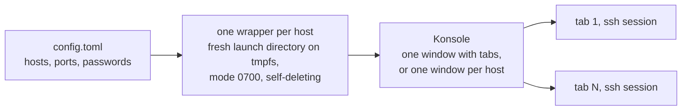

# SshAutoLogin.jl

[](https://github.com/PaulGoG/SshAutoLogin.jl/actions/workflows/CI.yml)
[](https://github.com/PaulGoG/SshAutoLogin.jl/releases/latest)
[](LICENSE)
[](https://julialang.org)
[](#environment-setup)
[](https://github.com/JuliaTesting/Aqua.jl)

Opens one KDE Konsole tab, or one window, per remote host listed in a TOML file and logs in to each with its password.

```
SshAutoLogin/
├── src/                   # Package: configuration parser, wrapper scripts, launcher, CLI driver
├── scripts/run.jl         # Command-line entry point
├── sandbox/run.jl         # CLI exercised against a stub emulator, no network
├── test/                  # Test suite and its environment
├── format/                # Formatting environment and script
├── config.example.toml    # Configuration template
├── activate.jl            # Activates and instantiates the root environment
├── Project.toml
├── CHANGELOG.md
└── SECURITY.md
```

The complete tree is under [Repository layout](#repository-layout).

## Environment setup

Linux with a systemd user session, which provides `XDG_RUNTIME_DIR`; the launcher refuses to run without it. Fedora with KDE Plasma is the development platform; any distribution that ships Konsole works. The launcher needs Konsole, Bash, the OpenSSH client, and `sshpass` 1.06 or newer:

```bash
sudo dnf install konsole openssh-clients sshpass
```

Julia 1.10 or newer.

Clone the repository and instantiate the environments:

```bash
git clone https://github.com/PaulGoG/SshAutoLogin.jl.git
cd SshAutoLogin.jl
julia activate.jl          # root environment
julia test/activate.jl     # test environment, developed against the local source
julia format/activate.jl   # formatting environment
```

The package is not registered; run it from the clone.

## Entry points

Copy the template with mode 600 and fill in the targets; the launcher refuses a configuration readable by other users, and git ignores every `.toml` file except the template and the environment files.

```bash
install -m 600 config.example.toml config.toml
```

| Task | Command |
|---|---|
| Open all sessions | `julia scripts/run.jl` |
| Use another configuration file | `julia scripts/run.jl --config path/to/config.toml` |
| Print the emulator commands without launching | `julia scripts/run.jl --dry-run` |
| Run the test suite | `julia test/runtests.jl` |
| Exercise the CLI against a stub emulator, no network | `julia sandbox/run.jl` |
| Format the sources | `julia format/format.jl` |
| Check formatting without writing | `julia format/format.jl --check` |

Every script activates its own environment, so `--project` is never needed. `scripts/run.jl` only calls `SshAutoLogin.main(args; io, err)`, which returns the exit status (0 on success, 1 on a usage, configuration, missing-binary, or missing-runtime-directory error) and writes the dry-run listing to `io` and the diagnostics to `err`. The configuration path may be given once, as `--config PATH` or as a bare argument.

From Julia:

```julia
using SshAutoLogin
config = load_config("config.toml")
plan_sessions(config)      # emulator commands, no side effects
launch_sessions(config)    # opens the sessions and returns the emulator processes
SshAutoLogin.main(["--dry-run", "config.toml"])   # the command-line driver, in process
```

## Component status

| Component | Status |
|---|---|
| TOML configuration parser and field validation | Stable |
| Konsole `tabs` and `windows` layouts, `hold` option | Stable; covered by launch tests against a stub emulator |
| Credential delivery to `sshpass` over a file descriptor | Stable; redaction asserted by the test suite and the sandbox |
| Terminal emulators other than Konsole | Not implemented |
| Key-based authentication | Not implemented; planned |

## How it works



The password never reaches a command line or an environment; [Security model](#security-model) has the details.

## Configuration

```toml
[globals]
connect_timeout = 10                     # integer > 0; units: s
strict_host_key_checking = "accept-new"  # one of: "accept-new" | "yes" | "no"
log_level = "ERROR"                      # OpenSSH LogLevel

[terminal]
emulator = "konsole"                     # one of: "konsole"
mode = "tabs"                            # one of: "tabs" | "windows"
hold = false                             # keep the tab open after the session ends
launch_settle_timeout = 30               # number > 0; units: s

[[targets]]
host = "192.168.1.100"                   # host name, IPv4 address, or IPv6 literal
port = 22                                # integer in [1, 65535]
user = "admin"
password = "example_password_1"
title = "Cluster Node 01"                # optional; default: user@host:port
strict_host_key_checking = "accept-new"  # optional per-target override
```

The parser rejects unknown keys, wrong value types, and values outside the documented constraints, naming the offending key. Host names must satisfy RFC 1123; IPv4 and IPv6 literals are accepted as well, the latter without square brackets, which `ssh` does not strip. Account names must be a letter or underscore followed by letters, digits, `.`, `_`, or `-`; passwords must be non-empty and free of control characters; titles must not contain `;` or `%`, which Konsole interprets as a property separator and as a format placeholder.

## How a session is opened

For every launch the launcher creates a fresh directory under `$XDG_RUNTIME_DIR/ssh-autologin/` (mode 0700, on an in-memory file system) and writes one short Bash script per target into it. The script removes itself as its first action, hands the password to `sshpass` through a pipe on file descriptor 3, and replaces itself with `sshpass -d 3 ssh ...`. In `tabs` mode Konsole is started once with `--tabs-from-file` pointing at a list with one script per tab; in `windows` mode Konsole is started once per target. Konsole runs in its own process (`--separate`), detached from the launcher's session, so an interrupt of the launcher does not reach the sessions. The launcher then waits, at most `launch_settle_timeout` seconds, until every script has removed itself, and removes the launch directory. If the emulator exits before executing every script, the directory is removed as well and a warning names the scripts left; if the wait times out while the emulator is still running, the directory is kept with a warning, and a later launch removes it once it is older than the settle timeout.

With `hold = true` the script does not replace itself: it waits for the SSH session to end, prints the exit status, and waits for Enter before the tab closes. Because this is implemented in the script rather than with Konsole's `--hold`, it applies to every tab. With `hold = false` a failed login closes the tab at once; set `hold = true` to read the error.

## Security model

The password is read from `config.toml`, which must not be readable by other users (the loader refuses any other mode), and written into the wrapper script, which lives in a launch directory of mode 0700 on tmpfs and unlinks itself when executed; under normal operation it exists for a fraction of a second. `sshpass -d` reads the password from a pipe, so it never appears in a process environment or an argument vector (`ps`, `/proc/*/cmdline`, `/proc/*/environ`). No log record, `show` rendering, or `--dry-run` listing contains a password. `ssh` runs with public-key authentication disabled and the preferred methods pinned to keyboard-interactive and password, so an agent holding many keys cannot exhaust the server's authentication attempts and an encrypted key cannot raise a passphrase prompt that `sshpass` does not answer.

The threat model is a single-user workstation. A process running under the same account can read the wrapper during its short lifetime, and the package does not defend against a compromised account or a hostile administrator. Host-key verification follows the configured policy: `accept-new` (default) trusts a host on first contact and refuses a changed key, `yes` requires the key to be known already, and `no` disables verification.

Vulnerability reports: see [SECURITY.md](SECURITY.md).

## Limitations

Linux and Konsole only. Authentication is by password; for hosts that accept keys, `ssh` with an agent is the better tool. Key-based targets are planned.

## Repository layout

<details>
<summary>Full file tree</summary>

```
SshAutoLogin/
├── .github/
│   ├── dependabot.yml         # Weekly updates of the GitHub Actions pins and the test and formatting environments
│   └── workflows/
│       └── CI.yml             # Test suite and formatting check on Julia LTS, stable, and pre-release
├── .gitignore                 # Every .toml except the tracked ones, coverage and editor artifacts
├── .JuliaFormatter.toml       # Formatting rules (YAS style)
├── CHANGELOG.md               # Release history
├── LICENSE                    # MIT
├── Project.toml               # Package metadata and compat bounds
├── README.md
├── SECURITY.md                # Threat model and vulnerability reporting
├── activate.jl                # Activates and instantiates the root environment
├── config.example.toml        # Configuration template
├── format/
│   ├── Project.toml           # Formatting environment (JuliaFormatter 2.14+)
│   ├── activate.jl            # Activates the formatting environment
│   └── format.jl              # Formats the repository; --check verifies without writing; refuses files that do not parse
├── sandbox/
│   └── run.jl                 # Exercises the CLI in process against a stub emulator, no network
├── scripts/
│   └── run.jl                 # Thin entry point around SshAutoLogin.main
├── src/
│   ├── SshAutoLogin.jl        # Module and exports
│   ├── validation.jl          # Field constraints and patterns
│   ├── types.jl               # SshTarget, GlobalConfig, TerminalOptions, SessionConfig
│   ├── config.jl              # TOML parsing with schema checks
│   ├── process.jl             # Wrapper scripts, emulator commands, launch logic
│   └── cli.jl                 # Command-line driver: argument parsing, main
└── test/
    ├── Project.toml           # Test environment (Aqua, JET, ExplicitImports)
    ├── activate.jl            # Activates the test environment against the local source
    └── runtests.jl
```

</details>

## License

MIT, see [LICENSE](LICENSE).
